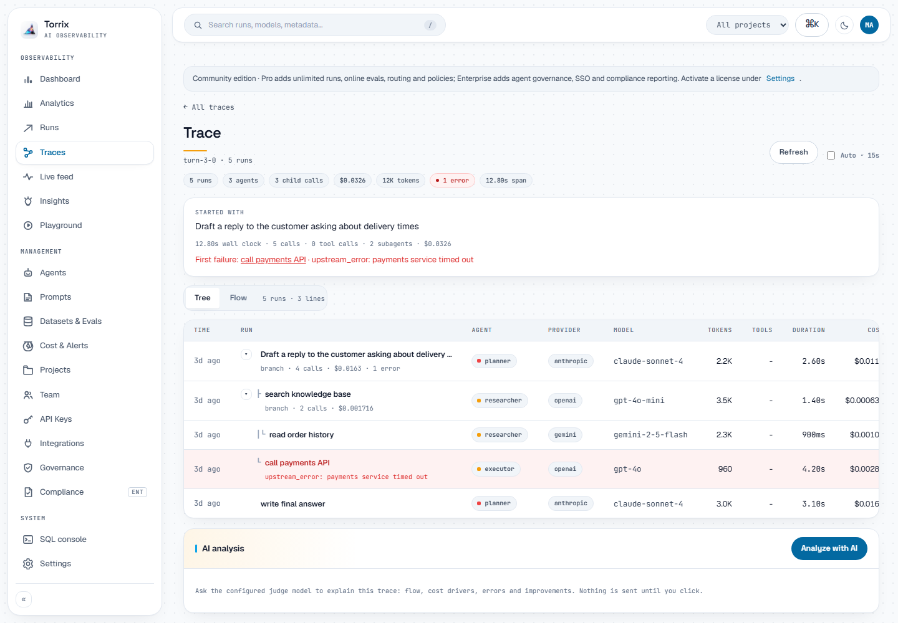

# How Torrix organizes your data

Torrix records every AI call as a **run**, then groups runs so you can follow what an app or agent
did. Five ideas cover almost everything.

## Run

A run is one call to a model, or one tool call made through Torrix. It holds:

- the prompt and response (including reasoning and tool calls when the provider returns them)
- the model and provider
- input, output, reasoning and prompt cache tokens
- cost and duration
- status, and the error message if it failed

Calls that fail are recorded too, with the provider's error, and they stay in their trace so you
can see where a turn stopped.

## Trace

A trace is **one turn of work**: everything that happened because of a single user request.
For a chat app that is usually one question and its answer. For an agent it is the plan, every
model call, every tool call and every subagent it started.

Each trace page shows:

- a summary at the top: the prompt that started it, total time, number of calls and tool calls,
  cost, and the first failure if there was one
- a **Tree** view of who started what, with the duration, cost and error of every step, and
  totals for each branch
- a **Flow** view that lays the same steps out on a timeline, one lane per agent

If your app does not send a trace id, every run becomes its own one-run trace. That still works,
but sending a trace id per user turn makes multi-step work much easier to read.

## Session

A session is **a whole conversation**: many turns from the same user or task over time. The
session page lists one row per turn (trace) and the runs below it. Long sessions are split into
pages of 200 runs and open on the most recent page.

## Agent and parent run

`agent_name` says who made a call: `planner`, `researcher`, `claude-code`, `support-bot`.

`parent_run_id` says which call started this one. That is how subagents appear under the step
that launched them. Calls made one after another by the same agent are **siblings**, not
children, so a long agent loop stays easy to scan instead of becoming a deep staircase.

The **Agents** page lists every agent seen in your runs with its call count, cost and errors.

## Project

A project separates data for different apps or teams. Every API key belongs to a user and can be
limited to certain projects. Pick the project with the `x-torrix-project` header or the
`project_id` field, or let Torrix use your default project.

## How each integration fills these in

You rarely set these fields by hand. The integrations do it for you:

| Integration | Session | Trace (one turn) | Parent / agent |
|---|---|---|---|
| HTTP proxy | `x-torrix-session` header | `x-torrix-trace` header, or the W3C `traceparent` header | `x-torrix-parent-run-id`, `x-agent-name` |
| Python and TypeScript SDKs | `run_context` / `runContext` | one per context block | nested contexts become children |
| Claude Code plugin | the Claude Code session | each prompt you type | subagents hang under the call that started them |
| opencode plugin | the root opencode session | each user turn | subagents hang under the parent agent's call |
| OpenTelemetry | `session.id` or `gen_ai.conversation.id` | the span's trace id | the parent span |

## Time and cost

- Every run is placed on the timeline at the moment the call **started**, and its duration covers
  the whole call, including streaming. For streamed calls the time to first token is shown as an
  event on the run.
- Cost uses each model's price, including prompt cache reads and writes for Claude models. If a
  model shows $0, add its price under **Cost & Alerts > Pricing**. Prices for popular models are
  refreshed automatically once a day.
